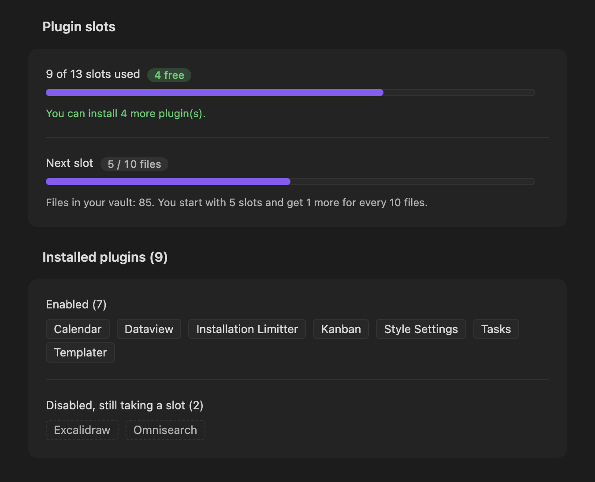
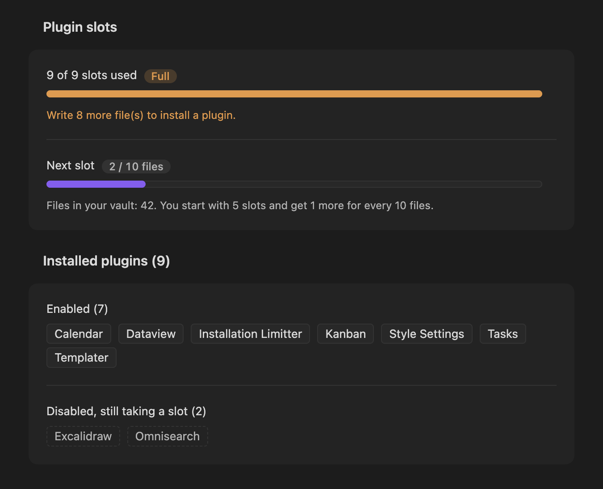
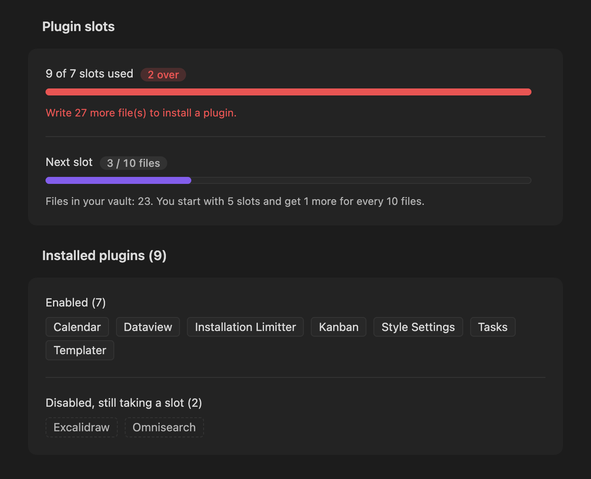
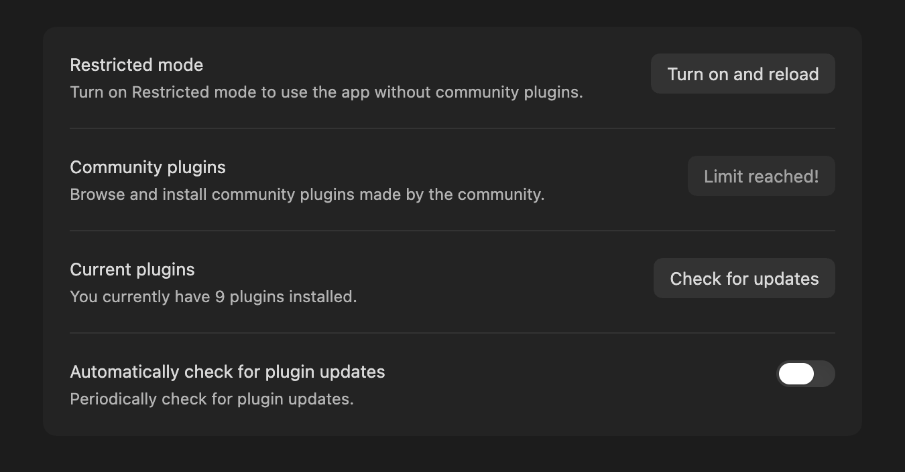

# Installation Limitter

A minimalist Obsidian plugin designed to help you stay focused on writing and creating content, rather than constantly tinkering with new plugins.

## Motivation
Obsidian is an incredibly powerful tool with a vibrant community plugin ecosystem. However, it's very easy to fall into the trap of "productivity procrastination" — endlessly browsing, installing, and configuring plugins instead of actually thinking and writing.

The **Installation Limitter** gently enforces a limit on the number of community plugins you can install. It gamifies your plugin usage: to earn the right to install another tool, you first have to produce more notes!

## How It Works
The plugin tracks the total number of files in your Obsidian Vault and determines your maximum plugin allowance based on that number. If you reach your limit, the "Browse" button in the Community Plugins settings and the "Install" button in the plugin browser will be temporarily disabled until you create more files.

When you reach the limit, the disabled buttons will display the tooltip:
> *"You've reached the productive number of plugins, use Obsidian more to unlock the ability to install more plugins."*

### The Math Inside 🧮
Your plugin limit is calculated using the following straightforward formula:

`Maximum Plugins = 5 + Math.floor(Total Files / 10)`

- **Base Limit:** Everyone starts with a minimum allowance of **5 community plugins**, regardless of vault size.
- **Scaling Limit:** For every **10 additional files** in your vault, your maximum allowed plugin count increases by **1**.

*Example:*
- 0 to 9 files: 5 plugins allowed
- 10 to 19 files: 6 plugins allowed
- 50 to 59 files: 10 plugins allowed
- 100 to 109 files: 15 plugins allowed

## Installation

### Manual Installation (Local Testing)
1. Download the latest release from the [Releases](https://github.com/mainarthur/obsidian-plugins-limitter/releases) page (if available), or build it from source.
2. In your Obsidian vault, navigate to `.obsidian/plugins/`.
3. Create a new folder named `plugins-limitter`. The folder name must match the `id` in `manifest.json` (see the [Obsidian manifest docs](https://docs.obsidian.md/Reference/Manifest)).
4. Copy the `main.js`, `manifest.json` and `styles.css` files into this folder.
5. Restart Obsidian or reload your plugins.
6. Go to **Settings** → **Community plugins** and enable "Installation Limitter".

### Building from Source
1. Clone this repository to your local machine.
2. Open a terminal in the cloned directory.
3. Run `npm install` to install dependencies.
4. Run `npm run build` to compile the plugin.
5. Copy the generated `main.js`, `manifest.json` and `styles.css` to your vault's `.obsidian/plugins/plugins-limitter/` directory. The folder name must match the `id` in `manifest.json` ([Obsidian manifest docs](https://docs.obsidian.md/Reference/Manifest)).

## Usage
Once installed and enabled, the plugin works entirely in the background. 
1. Just use Obsidian normally!
2. When you attempt to browse or install new community plugins in your Settings, the plugin will check your file count vs. your installed plugin count.
3. If you are under the limit, you can install plugins as usual.
4. If you have hit the ceiling, the install buttons will grey out, prompting you to go write more notes!

Disabled plugins still count toward the limit, since they stay installed. Open **Settings → Installation Limitter** to see how many slots you use, how many files until the next slot, and which disabled plugins still take one.

## Screenshots

### Dashboard in the settings

The color of the slots bar shows where you stand.

**Green: slots are free.** You can install more plugins.

**Yellow: every slot is used.** Write more notes to earn the next slot.

**Red: over the limit.** You have more plugins installed than your vault allows, for example after deleting notes or installing plugins before you enabled Installation Limitter. Write more notes or uninstall plugins to get back under it.

### The blocking message

When you are at or over the limit, the **Browse** button in **Settings → Community plugins** turns into a disabled **Limit reached!** button.

## License
MIT
